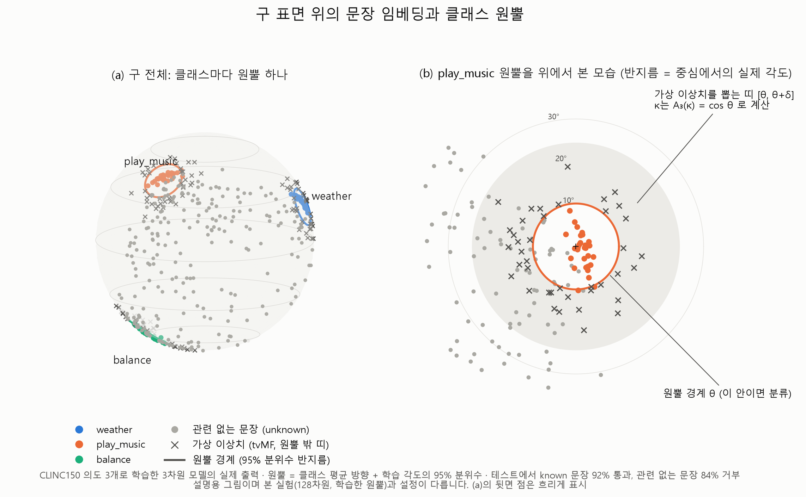
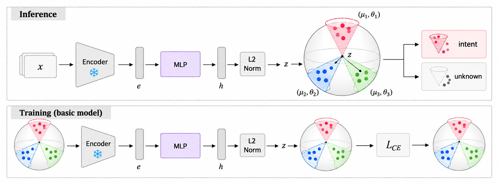
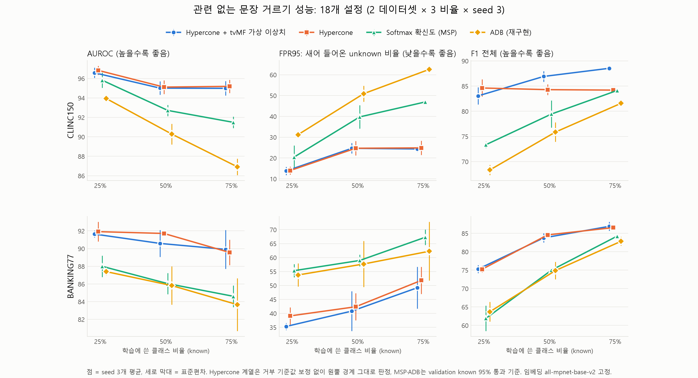
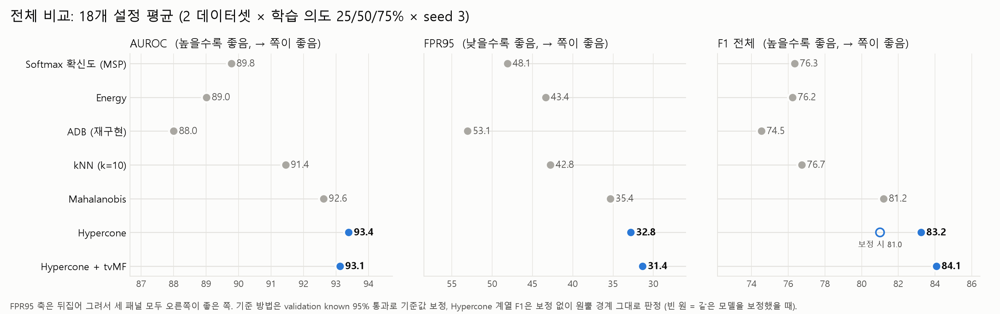
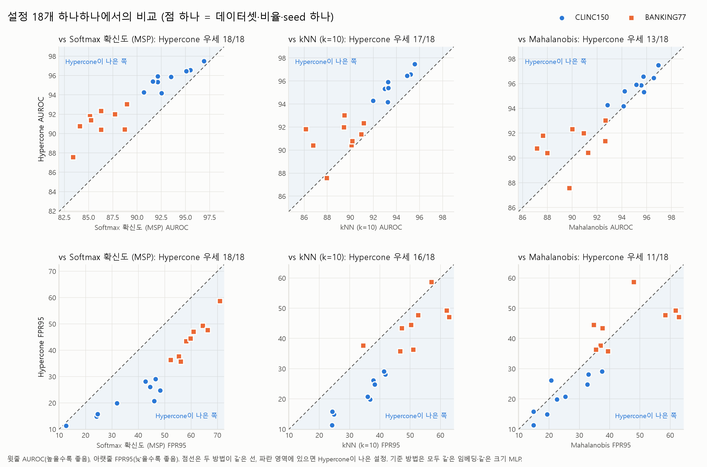
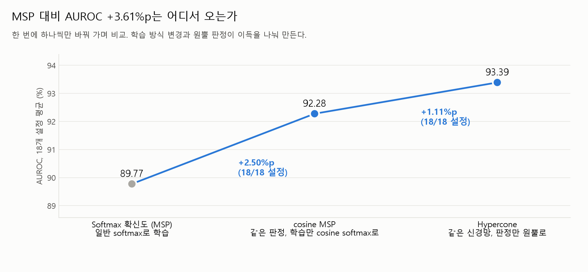
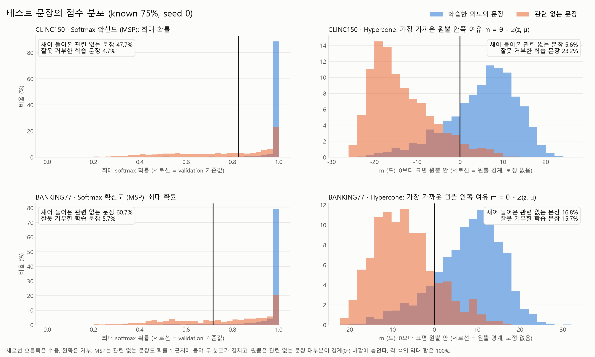

# ITS: 구 위의 원뿔로 의도를 분류하고, 관련 없는 문장은 거부하기

챗봇이나 음성 비서는 정해진 의도(intent) 중 하나로 사용자 문장을 분류한다. 하지만 사용자는 그 의도 목록에 없는 말도 한다.
이 프로젝트는 **문장 임베딩을 단위 구 위에 놓고, 의도마다 원뿔(hypercone)을 하나씩 세워서**
어느 원뿔 안에 들어온 문장은 그 의도로 분류하고, 어느 원뿔에도 들어오지 않은 문장은 "모르는 문장"으로 거부한다.

원뿔이라는 기하는 HyperSphereDiff(Dosi et al., ICML 2025)에서 가져왔다. 그 논문은 원뿔과 truncated vMF 분포로 **생성 샘플을 클래스 안에 가두는 데** 썼고,
여기서는 같은 도구를 **분류하고 거부하는 데** 쓴다. 상위 폴더의 `hsdiff/sphere.py`(vMF 샘플러, Bessel 비율)를 그대로 가져다 쓴다.

**결과 한 줄 요약**: 두 벤치마크의 18개 설정에서 원뿔 분류기는 softmax 확신도(MSP), Energy, kNN, ADB보다 일관되게 좋았다(모두 p < 0.01).
가장 강한 기준인 Mahalanobis와는 통계적으로 같은 수준인데, 원뿔은 클래스당 방향 하나와 반지름 하나만 쓰고 거부 기준값을 따로 맞추지 않아도 된다.

---

## 1. 풀려는 문제

은행 챗봇이 "잔액 조회", "송금", "카드 분실" 같은 의도를 학습했다고 하자. 사용자가 "피자 주문해줘"라고 입력하면 어떻게 될까?

- 보통의 softmax 분류기는 확률을 학습한 의도들끼리 나눠 갖는다. 그래서 "피자 주문해줘"도 그중 하나, 예를 들어 "송금"으로 분류된다.
  거부라는 선택지가 애초에 없다.
- 그래서 흔히 "확신도가 낮으면 거부"하는 장치를 덧붙인다(MSP, Energy, Mahalanobis 등).
- 어려운 점은 **사용자가 할 엉뚱한 말을 미리 다 모을 수 없다**는 것이다. 거부 기준은 학습한 의도의 문장만 보고 정해야 한다.

이 프로젝트의 규칙도 같다. **관련 없는 문장(unknown)은 학습에도, 하이퍼파라미터 선택에도 쓰지 않는다.** 테스트에서만 처음 본다.

## 2. 무엇이 다른가

### 2.1 판정 규칙의 차이
기존 거부 방법들은 "점수를 하나 계산하고, 기준값 τ보다 낮으면 거부"한다. τ는 데이터마다 따로 맞춰야 하고, 그 숫자 자체에는 뜻이 없다.
원뿔은 **각 클래스의 반지름이 곧 거부 기준**이다. 반지름은 "중심 방향에서 몇 도 이내"라는 각도라서 그대로 읽힌다.

| 방법 | 점수 (클수록 학습한 의도) | 거부 조건 | 거부 기준을 정하는 것 |
|---|---|---|---|
| MSP | $\max_k \mathrm{softmax}(Wh)_k$ | 점수 $< \tau$ | 전역 기준값 $\tau$ (보정 필요) |
| Energy | $\log \sum_k \exp\big((Wh)_k\big)$ | 점수 $< \tau$ | 전역 기준값 $\tau$ (보정 필요) |
| Mahalanobis | $-\min_k (h - \bar{h}_k)^\top \Sigma^{-1} (h - \bar{h}_k)$ | 점수 $< \tau$ | 전역 기준값 $\tau$ (보정 필요) + 공분산 $\Sigma$ |
| kNN | $-\lVert \hat{h} - \hat{h}_{(k')} \rVert$ | 점수 $< \tau$ | 전역 기준값 $\tau$ (보정 필요) + 학습 문장 전체 저장 |
| ADB | $\max_k \big(\Delta_k - \lVert h - \bar{h}_k \rVert\big)$ | 점수 $< 0$ | 클래스별 유클리드 반지름 $\Delta_k$ |
| **Hypercone (제안)** | $\max_k \big(\theta_k - \angle(z, \mu_k)\big)$ | 점수 $< 0$ | **클래스별 각도 반지름 $\theta_k$** |

$h$는 정규화 전 MLP 출력, $z = h / \lVert h \rVert$, $\bar{h}_k$는 클래스 평균, $\hat{h}_{(k')}$는 $k'$번째 이웃이다.
ADB와 원뿔은 둘 다 클래스별 닫힌 영역이지만, ADB의 거리는 벡터 길이 차이도 세고 원뿔의 각도는 방향 차이만 본다(4절에서 예시로 설명).

### 2.2 관련 연구와의 위치
| 연구 | 무엇을 했나 | 이 프로젝트와의 차이 |
|---|---|---|
| MSP (ICLR 2017), Energy (NeurIPS 2020) | 분류기 출력의 확신도로 거부 | softmax는 공간 전체를 나눠 가져서 먼 입력도 높은 확신을 받는다. 원뿔은 클래스별 닫힌 영역 |
| Mahalanobis (NeurIPS 2018) | 클래스 평균·공유 공분산 거리로 거부 | 공분산 추정과 기준값 보정이 필요. 원뿔은 방향과 각도만 쓴다 |
| kNN (ICML 2022) | k번째 이웃까지 거리로 거부 | 학습 문장 전체를 저장하고 매번 거리를 계산. 원뿔은 클래스당 방향·반지름 하나씩 |
| ADB / DA-ADB (AAAI 2021, 2022) | 클래스별 유클리드 공 경계 (텍스트 intent) | 각도 원뿔 경계 |
| LMCL + LOF (ACL 2019) | 각도 margin으로 학습 후 LOF로 거부 (텍스트) | 각도를 쓰지만 클래스별 영역을 정의하지 않는다 |
| VOS / NPOS (ICLR 2022, 2023) | Gaussian 저확률 영역에서 가상 이상치 생성 (이미지) | 구 위, 원뿔 밖 띠에서 truncated vMF로 생성 |
| DCLOOS (ACL 2021) | 텍스트 intent에서 pseudo outlier 생성 | 구·원뿔 기하 기반 생성 |
| HyperSphereDiff (ICML 2025) | 원뿔과 truncated vMF로 클래스 구조를 보존하는 **생성** | 같은 기하를 **분류·거부**에 적용. tvMF를 자르는 영역을 원뿔 안에서 원뿔 **밖** 띠로 뒤집었다 |

### 2.3 기여
1. **텍스트 open-set 분류에 클래스별 각도 원뿔을 결정 경계로 사용.** 흔히 쓰는 거부 방법(MSP, Energy, kNN, ADB)보다 18개 설정에서 일관되게 좋고,
   가장 강한 Mahalanobis와 같은 수준의 성능을 클래스당 방향 하나·반지름 하나로 낸다.
2. **반지름 자체가 거부 기준.** 기준값을 맞추지 않고 원뿔 경계 그대로 판정해도 되고, 그때 F1이 오히려 가장 높다.
   판정 이유를 "원뿔 중심에서 몇 도, 반지름은 몇 도"로 설명할 수 있다.
3. **(보조) 원뿔 밖 띠로 잘라낸 vMF 가상 이상치.** 집중도 κ를 원뿔 반지름에서 계산해서, 새로 정할 값은 띠 폭 δ 하나다.
   경계 그대로 판정할 때 F1이 가장 높았지만(84.07), 순위 지표(AUROC) 이득은 작다.

**주장하지 않는 것**: 텍스트를 구·vMF로 다루는 것, open-set intent 분류, 각도 margin, 가상 이상치로 거부를 학습하는 것 자체는 기존에 있다.
"원뿔이 모든 방법보다 크게 낫다"도 주장하지 않는다. Mahalanobis와의 차이는 통계적으로 유의하지 않다(7.1절).

## 3. 방법 한눈에 보기



위 그림은 설명을 위해 모델 출력을 3차원으로 줄여서 실제로 학습시킨 결과다(본 실험은 128차원).
CLINC150의 의도 3개(weather, play_music, balance)만 학습했다.

- **색깔 점**: 학습한 의도의 문장. 같은 의도끼리 구 위의 한 방향에 모인다.
- **원**: 그 의도의 원뿔 경계. 원뿔은 "중심 방향 $\mu_k$에서 각도 $\theta_k$ 이내"인 영역이다.
- **회색 점**: 학습하지 않은 관련 없는 문장. 대부분 어느 원뿔에도 들어가지 않는다.
- **× 표시**: 가상 이상치(확장 기능, 5.2절). 원뿔 경계 바로 바깥에 일부러 찍은 가짜 점이다.

오른쪽 (b)는 play_music 원뿔을 위에서 내려다본 모습이다. 중심에서 약 10° 이내가 원뿔이고, 그 바깥 띠에 가상 이상치가 놓여 있다.
이 3차원 모델에서도 학습한 의도의 테스트 문장은 92%가 통과했고, 관련 없는 문장은 84%가 거부됐다.

문장 하나가 들어오면 구 위의 점 $z$가 된다. 클래스마다 "원뿔 안쪽으로 얼마나 들어와 있는지" $m_k$를 재고, 하나라도 0 이상이면 분류, 모두 음수면 거부한다.

$$
m_k(z) = \theta_k - \angle(z, \mu_k), \qquad
\hat{y} =
\begin{cases}
\arg\max_k \, m_k(z) & \text{if } \max_k m_k(z) \ge 0 \\
\text{unknown (거부)} & \text{otherwise}
\end{cases}
$$

## 4. 왜 이렇게 설계했나

**문장을 구 위에 놓는 이유**
문장 임베딩은 벡터 길이보다 방향으로 뜻을 비교한다(코사인 유사도). 그래서 정규화해서 구 위에 놓아도 뜻에 관한 정보는 거의 잃지 않는다.
많은 문장 인코더가 출력을 이미 정규화해서 내놓는다. 구는 억지로 만든 가정이 아니라 원래 문장 임베딩이 놓인 자리다.

**softmax 대신 원뿔을 쓰는 이유**
softmax는 공간 전체를 클래스끼리 나눠 갖는다. 그래서 모든 클래스와 멀리 떨어진 문장도 결국 어딘가에 배정된다.
원뿔은 클래스마다 닫힌 영역이다. "어느 원뿔에도 없음 = 거부"가 구조 자체에 들어 있다.

**유클리드 공(ADB) 대신 원뿔을 쓰는 이유**
ADB는 클래스 중심 주위에 유클리드 공을 씌운다. 그런데 공은 벡터의 **길이 차이도 거리로 센다.**
중심이 (3, 0)이고 반지름이 1인 공이 있을 때를 보자.

| 문장 벡터 | 중심과 방향 차이 | 중심까지 거리 | 공 (반지름 1) | 원뿔 (10°) |
|---|---|---|---|---|
| (6, 0) | 0° (같은 방향 = 같은 뜻) | 3 | 거부 | 수용 |
| (3, 1) | 약 18° | 1 | 수용 | 거부 |

공은 뜻과 상관없는 길이 때문에 판정이 뒤집힌다. 원뿔은 방향만 보므로 이런 일이 없다.
반지름도 "중심에서 10° 이내"처럼 feature 크기와 상관없이 같은 뜻으로 읽힌다.

**반지름을 클래스마다 다르게 두는 이유**
의도마다 표현의 폭이 다르다. "날씨 알려줘"는 말하는 방식이 몇 가지 안 되지만, "잡담"은 매우 다양하다.
반지름을 하나로 통일하면 좁은 클래스에는 엉뚱한 문장이 들어오고, 넓은 클래스는 진짜 해당하는 문장을 거부한다.

**가상 이상치를 만드는 이유 (확장)**
관련 없는 문장 데이터가 없으니, 원뿔 경계 바로 밖에 가짜 점을 찍어 "여기부터 거부"를 가르친다.
이 가짜 점은 문장이 아니라 임베딩 공간의 벡터다(LLM으로 가짜 문장을 만드는 것이 아니다).
가상 이상치라는 아이디어 자체는 VOS, DCLOOS 등에 이미 있다. 여기서 다른 점은 **구 위, 원뿔 바로 밖 띠에, truncated vMF로** 놓는다는 것이다.

**Gaussian 대신 truncated vMF를 쓰는 이유 (확장)**
Gaussian은 평평한 공간의 분포라서 뽑은 점이 구를 벗어나고, 원하는 위치에 놓기도 어렵다.
vMF는 구 위의 분포이고, 잘라내면(truncated) 원뿔 바깥 띠 $[r_k, r_k + \delta]$에만 점이 떨어진다.
vMF의 집중도 $\kappa$는 원뿔 반지름에서 계산하므로(식 10), 사람이 새로 정할 값은 띠 폭 $\delta$ 하나뿐이다.

## 5. 모델 구조와 수식



위는 추론, 아래는 기본 모델의 학습이다. 문장 $x$를 고정된 인코더에 넣어 $e$를 얻고, 학습하는 MLP로 $h$를 만든 뒤 정규화해서 구 위의 점 $z$로 보낸다.
추론 때는 $z$가 어느 원뿔 $(\mu_k, \theta_k)$ 안에 있는지로 의도를 고르거나 거부하고, 학습 때는 $\mathcal{L}_{\text{CE}}$로 같은 의도의 문장을 한 원뿔로 모은다.

차원과 하이퍼파라미터는 기호로 두고, 실험에서 쓴 값은 표에 모았다. 수식만 따로 모은 문서는 `equations.md`다.

| 기호 | 뜻 | 실험 값 |
|---|---|---|
| $\mathbb{S}^{n-1}$ | $n$차원 단위 구 $\{v \in \mathbb{R}^n : \lVert v \rVert = 1\}$ | |
| $D$ | 문장 인코더 출력 차원 (입력 구 $\mathbb{S}^{D-1}$) | 768 (`all-mpnet-base-v2`) |
| $d$ | 정규화된 feature 차원 (feature 구 $\mathbb{S}^{d-1}$) | 128 (MLP $D \to 512 \to d$, GELU, dropout 0.1) |
| $K$ | 학습한 의도 수 | 데이터셋·분할마다 다름 |
| $\angle(a,b)$ | 두 단위 벡터 사이의 각도 $\arccos(a^\top b)$ | |
| $s$ | cosine softmax의 scale | 16 |
| $q$ | 원뿔 반지름을 정하는 분위수 | 0.95 |
| $\alpha$, $\beta$ | 확장 손실 가중치 | 1, 1 |
| $\delta$ | 가상 이상치 띠 폭 (라디안) | 0.15 (입력 공간), 0.1 (feature 공간) |

학습은 30 epoch, Adam(lr 1e-3), batch 128. 인코더는 학습하지 않고, 임베딩을 한 번 계산해서 캐시한다.

### 5.1 기본 모델 `cone_q`

**(1) 문장을 구 위의 점으로**

$$
e = f_{\text{enc}}(x) \in \mathbb{S}^{D-1}, \qquad
h = g_\varphi(e) \in \mathbb{R}^d, \qquad
z = \frac{h}{\lVert h \rVert} \in \mathbb{S}^{d-1}
$$

$f_{\text{enc}}$는 고정된 문장 인코더, $g_\varphi$는 학습하는 MLP다. 비교하는 모든 방법이 같은 인코더와 같은 크기의 MLP를 쓴다.

**(2) 클래스마다 원뿔 하나**

$$
C_k = \{\, z \in \mathbb{S}^{d-1} : \angle(z, \mu_k) \le \theta_k \,\}, \qquad
\mu_k = \frac{p_k}{\lVert p_k \rVert}
$$

$p_k \in \mathbb{R}^d$는 학습하는 prototype 벡터다.

**(3) 원뿔 안쪽 여유**와 **(4) 판정 규칙**은 3절의 식 그대로다. $m_k > 0$이면 원뿔 $k$ 안이고, 단위는 각도(라디안)다.

**(5) 학습: cosine softmax**

$$
\mathcal{L}_{\text{CE}} = -\log
\frac{\exp\!\big(s \cdot \cos(z, \mu_y)\big)}{\sum_{j=1}^{K} \exp\!\big(s \cdot \cos(z, \mu_j)\big)}
$$

$\varphi$와 $p_k$를 학습한다. 같은 의도의 문장은 $\mu_y$ 방향으로 모이고, 다른 의도의 중심과는 멀어진다.

**(6) 반지름: 학습 문장 각도의 $q$ 분위수**

$$
\theta_k = Q_{q}\big(\{\, \angle(z_i, \mu_k) : y_i = k \,\}\big)
$$

학습이 끝난 뒤 한 번 계산한다. 클래스 $k$ 학습 문장의 $q$ 비율을 품는 가장 작은 원뿔이다(HyperSphereDiff의 원뿔 정의).

### 5.2 확장 모델 `cone_tvmf`: 원뿔 밖 가상 이상치

**(7) 반지름도 학습 파라미터로**: $\theta_k = \pi \cdot \sigma(\rho_k)$. $\sigma$는 sigmoid라서 $\theta_k$가 항상 $(0, \pi)$ 안에 있다.

**(8) 전체 손실**

$$
\mathcal{L} = \mathcal{L}_{\text{CE}}
+ \alpha \cdot \underbrace{\mathrm{relu}\big(\angle(z, \mu_y) - \theta_y\big)}_{\text{진짜 문장은 자기 원뿔 안으로}}
+ \beta \cdot \underbrace{\mathrm{relu}\Big(\max_k \big(\theta_k - \angle(\tilde{o}, \mu_k)\big)\Big)}_{\text{가상 이상치는 모든 원뿔 밖으로}}
$$

- 두 번째 항은 원뿔 밖으로 나간 진짜 문장이 있으면 $\theta_y$를 키우고 $z$를 중심으로 당긴다.
- 세 번째 항은 어떤 원뿔 안에 들어온 가상 이상치 $\tilde{o}$가 있으면 그 원뿔의 $\theta_k$를 줄이고 $\tilde{o}$를 밀어낸다.
- 두 힘이 맞서서, 반지름이 "진짜 문장은 품고 바로 바깥 띠는 내보내는" 크기에 자리 잡는다.

**(9) 가상 이상치: 원뿔 밖 띠로 잘라낸 vMF**

입력 구 $\mathbb{S}^{D-1}$에서 클래스마다 원뿔 $(c_k, r_k)$를 먼저 잡고, 그 바로 바깥 띠에서만 점을 뽑는다.

$$
c_k = \frac{\sum_{i:\,y_i=k} e_i}{\big\lVert \sum_{i:\,y_i=k} e_i \big\rVert}, \qquad
r_k = Q_{q}\big(\{\, \angle(e_i, c_k) : y_i = k \,\}\big)
$$

$$
o \sim p(o) \propto \exp\!\big(\kappa_k\, c_k^\top o\big) \cdot \mathbb{1}\big[\, r_k \le \angle(o, c_k) \le r_k + \delta \,\big], \qquad
\tilde{o} = \frac{g_\varphi(o)}{\lVert g_\varphi(o) \rVert} \in \mathbb{S}^{d-1}
$$

뽑은 점은 MLP를 통과하므로, 이상치의 gradient가 반지름뿐 아니라 표현 $\varphi$까지 바꾼다.
샘플링은 중심과의 각도 $\phi$의 밀도 $\propto \exp(\kappa \cos\phi)\sin^{n-2}\phi$를 띠로 잘라 역CDF로 뽑고, 방향은 접평면에서 균일하게 뽑는다(`hsdiff.sphere.sample_tvmf`).

**(10) 집중도 κ는 반지름에서 계산**

$$
A_n(\kappa_k) = \cos r_k, \qquad
A_n(\kappa) = \frac{I_{n/2}(\kappa)}{I_{n/2-1}(\kappa)} = \mathbb{E}_{o \sim \mathrm{vMF}(c,\kappa)}\big[\, c^\top o \,\big]
$$

$n$은 이상치를 뽑는 구의 차원(입력 공간 $n = D$), $I_\nu$는 제1종 수정 Bessel 함수다.
$A_n(\kappa)$는 vMF 샘플이 중심과 이루는 평균 cos 값이므로, 이 식은 "샘플이 평균적으로 원뿔 경계 근처에 놓이도록 $\kappa$를 고른다"는 뜻이다.
그래서 잘라낸 띠 안에 확률 질량이 충분히 있고, 사람이 정할 값은 띠 폭 $\delta$ 하나뿐이다.

### 5.3 가상 이상치를 뽑는 두 위치
| 버전 | 이상치를 뽑는 곳 | 차이 |
|---|---|---|
| feature 공간 (`--space feature`) | MLP를 지난 $\mathbb{S}^{d-1}$, $c_k = \mu_k$, epoch마다 $r_k$ 갱신 | 이상치가 MLP를 통과하지 않아서($\tilde{o} = o$) 반지름과 중심만 바뀐다 |
| 입력 공간 (`--space input`) | 인코더가 낸 $\mathbb{S}^{D-1}$, 식 (9) | 이상치가 MLP를 통과하므로 표현 자체도 바뀐다 |

입력 공간 버전이 더 좋았고, 결과 표의 "Hypercone + tvMF"는 이 버전이다.

### 5.4 "원뿔 경계 그대로" vs "validation 보정"
결과 표에 거부 기준이 두 가지로 나온다.

- **원뿔 경계 그대로 (`_raw`)**: 식 (4) 그대로, $\max_k m_k \ge 0$이면 수용한다. 기준값을 정하는 과정이 없다.
- **validation 보정**: MSP와 같은 규칙이다. validation의 학습한 문장 95%가 통과하도록 전역 기준값 $\tau$ 하나를 맞춰 $\max_k m_k \ge \tau$이면 수용한다.
  MSP, Energy, Mahalanobis, kNN, ADB는 기준값이 꼭 필요해서 모두 이 방식으로 판정했다.

두 방식 모두 unknown 데이터는 보지 않는다.

## 6. 실험 설정

### 데이터
| 데이터셋 | 내용 | 특징 |
|---|---|---|
| **CLINC150** (`clinc/clinc_oos`, plus) | 음성 비서 요청. 10개 분야 150개 의도, 의도당 train 100 / val 20 / test 30 | 어느 의도에도 안 속하는 **out-of-scope 문장**(test 1,000개)이 따로 있다. 예: "who played ronald weasly" |
| **BANKING77** (`mteb/banking77`) | 은행 고객센터 질문. 은행 한 분야 안의 77개 의도 | 의도끼리 매우 비슷해서(카드 도착 문의 / 카드 배송 추적 / 카드 미수령) 학습 안 한 의도를 가려내기 어렵다. validation이 없어서 train의 10%를 의도별로 뗐다 |

### 평가 프로토콜 (ADB 논문과 같음)
1. 의도 중 25% / 50% / 75%를 무작위로 골라 **학습한 의도(known)**로 정한다.
2. 학습과 validation에는 known 의도의 문장만 쓴다.
3. 테스트에서는 학습하지 않은 의도의 문장과 out-of-scope 문장을 모두 **unknown(거부가 정답)**으로 바꾼다.
4. 비율마다 seed 3개(0, 1, 2)로 known 의도를 다르게 뽑는다. → 2 데이터셋 × 3 비율 × 3 seed = **18개 설정**

예를 들어 CLINC150, known 75%, seed 0이면 학습한 의도는 112개다. 테스트 5,500개 중 3,360개가 학습한 의도, 2,140개가 unknown이다.

### 지표
| 지표 | 뜻 | 좋은 방향 |
|---|---|---|
| **AUROC** | known과 unknown을 점수로 얼마나 잘 줄 세우는가. 기준값과 무관하다 | 높을수록 |
| **FPR95** | 학습한 문장을 95% 통과시키는 기준에서, unknown이 새어 들어오는 비율 | 낮을수록 |
| **F1(전체)** | known 의도 각각과 unknown을 하나의 클래스로 쳐서 계산한 macro F1. 실제 기준값으로 판정한 결과다 | 높을수록 |

AUROC와 FPR95는 기준값과 상관없이 점수의 순서만 보므로, 같은 모델의 `_raw` 행과 보정 행에서 값이 같다. F1만 기준값에 따라 달라진다.

## 7. 결과

### 7.1 메인 비교 (18개 설정 평균, %)
| 방법 | 거부 기준 | AUROC ↑ | FPR95 ↓ | F1(전체) ↑ | F1(unknown) ↑ |
|---|---|---|---|---|---|
| Softmax 확신도 (MSP) | validation 보정 | 89.77 | 48.11 | 76.34 | 66.72 |
| Energy | validation 보정 | 89.01 | 43.36 | 76.23 | 69.65 |
| kNN (k=10) | validation 보정 | 91.45 | 42.77 | 76.74 | 72.04 |
| ADB (재구현) | validation 보정 | 88.00 | 53.06 | 74.53 | 61.94 |
| Mahalanobis | validation 보정 | 92.62 | 35.35 | 81.19 | 76.44 |
| Hypercone (`cone_q`) | validation 보정 | **93.39** | 32.80 | 81.00 | 76.69 |
| Hypercone (`cone_q`) | 원뿔 경계 그대로 | **93.39** | 32.80 | 83.24 | 85.24 |
| Hypercone + tvMF (입력 공간) | 원뿔 경계 그대로 | 93.12 | **31.35** | **84.07** | **85.47** |

읽는 법:
- **원뿔은 흔히 쓰는 방법보다 일관되게 좋다.** AUROC 기준으로 MSP·Energy보다 18/18 설정, kNN·ADB보다 17/18 설정에서 앞선다.
  MSP 대비 AUROC +3.6%p, FPR95는 15.3%p 낮다.
- **가장 강한 기준인 Mahalanobis와는 비슷하다.** AUROC +0.8%p(13/18 설정), FPR95 −2.6%p(11/18)지만, 같은 기준값 방식의 F1은 사실상 같다(−0.2%p).
- **기준값을 맞추지 않은 원뿔이 F1에서 가장 높다.** 원뿔은 반지름이 곧 기준이라 보정 없이 써도 되고, 그때 F1이 오히려 오른다(81.00 → 83.24).
  가상 이상치로 반지름을 학습하면 84.07로 전체 1위다.



설정별로 보면, 학습한 의도 비율이 늘어날수록(25% → 75%) 모든 방법이 unknown을 더 많이 놓친다(FPR95 상승).
그래도 원뿔 계열은 모든 비율, 두 데이터셋 모두에서 MSP·ADB보다 FPR95가 낮다. CLINC150에서는 격차가 특히 커서, 75%일 때 MSP 약 47%, 원뿔 약 25%다.
BANKING77은 의도끼리 비슷해서 모든 방법의 수치가 CLINC150보다 낮다.
(그림의 MSP·ADB는 validation 보정, Hypercone 계열은 원뿔 경계 그대로 판정했다.)



평균만 보면 우연일 수 있으니, 같은 설정(데이터셋·비율·seed)끼리 짝지어 비교했다. 점 하나가 설정 하나이고, 파란 영역에 있으면 원뿔이 나은 설정이다.



Wilcoxon 부호순위 검정(18쌍, 양측)으로 보면 MSP·Energy·kNN·ADB와의 차이는 AUROC·FPR95·F1 모두 p < 0.01이다.
Mahalanobis와는 AUROC p = 0.06, FPR95 p = 0.21, F1 p = 0.67로 **통계적으로 유의한 차이가 없다.** 전체 표와 검정 결과는 `results/summary.md`에 있다.

### 7.2 이득은 학습 방식 덕분인가, 원뿔 판정 덕분인가?
원뿔 모델은 cosine softmax로 학습하고, MSP·Mahalanobis는 일반 softmax로 학습했다. 그래서 차이가 학습 방식에서 왔을 수도 있다.
이를 가르려고 **원뿔과 똑같은 cosine 신경망 하나 위에서 판정 방식만 바꿔** 비교했다(모두 validation 보정).

| 판정 방식 (같은 cosine 신경망) | AUROC | FPR95 | F1 | 원뿔이 이긴 설정 (AUROC) |
|---|---|---|---|---|
| cosine MSP | 92.28 | 38.92 | 79.33 | 18/18 |
| Mahalanobis (정규화 feature) | 92.18 | 37.40 | 79.00 | 14/18 |
| Mahalanobis (정규화 전 feature) | 92.05 | 37.19 | 78.79 | 16/18 |
| kNN (k=10) | 93.46 | 32.84 | 81.10 | 9/18 |
| **원뿔** | 93.39 | 32.80 | 81.00 | — |

- 같은 신경망에서도 원뿔이 Mahalanobis보다 AUROC +1.2%p 높다. 학습 방식만의 효과가 아니다.
- MSP 대비 이득 +3.6%p는 cosine 학습(+2.5)과 원뿔 판정(+1.1)이 나눠서 만든다.
- kNN과는 동률이다. 하지만 kNN은 학습 문장 전체를 저장해 두고 매번 거리를 계산하고, 원뿔은 클래스당 방향 하나와 반지름 하나만 쓴다.
- 같은 신경망 위에서는 원뿔과 Mahalanobis의 차이가 유의하다(AUROC p = 0.002). 즉 원뿔 판정이 Mahalanobis 판정보다 낫다는 근거는 이 비교에서 나온다.



### 7.3 가상 이상치 종류 비교 (원뿔 경계 그대로 판정, F1(전체) %)
| 가상 이상치 | feature 공간에서 생성 | 입력 공간에서 생성 |
|---|---|---|
| 없음 (`cone_q`) | 83.24 | 83.24 |
| Gaussian 저확률 샘플 (VOS 방식) | 76.94 | 83.93 |
| vMF (자르지 않음) | 81.71 | — |
| **truncated vMF (원뿔 밖 띠)** | **82.01** | **84.07** |

- feature 공간에서 Gaussian 이상치로 반지름을 학습하면 원뿔이 너무 좁아져서, 보정 없이 판정하면 F1이 76.9로 무너진다. truncated vMF는 82.0으로 안정적이다.
- 입력 공간에서는 truncated vMF가 가장 좋지만, 이상치가 없을 때보다 +0.8%p로 차이가 크지 않다.
- AUROC로 보면 이상치 유무나 종류에 따른 차이가 대부분 ±0.5%p 이내다. 그래서 **가상 이상치는 보조 기여로 둔다.**

### 7.4 실제 문장에서는 어떻게 다른가
CLINC150, known 75%, seed 0에서 MSP와 Hypercone + tvMF(원뿔 경계 그대로)를 비교했다.

|  | MSP | Hypercone + tvMF |
|---|---|---|
| 학습한 의도 문장을 바르게 분류 | 93.3% | 84.7% |
| 학습한 의도 문장을 잘못 거부 | 4.7% | 14.5% |
| 관련 없는 문장을 거부 | 52.3% | **88.2%** |
| 관련 없는 문장이 새어 들어옴 | 47.7% | **11.8%** |

원뿔은 관련 없는 문장을 훨씬 많이 걸러내는 대신, 학습한 문장도 더 많이 거부한다.

점수 분포로 보면 이유가 보인다(이상치 없는 기본 원뿔, known 75%, seed 0).
MSP는 관련 없는 문장에도 확률 1 근처의 높은 확신을 줘서 두 분포가 크게 겹친다. 원뿔의 여유 m은 관련 없는 문장 대부분이 경계(0°) 바깥에 놓인다.
다만 경계를 보정 없이 쓰면 학습한 문장의 일부(CLINC150 23%, BANKING77 16%)도 경계 밖에 떨어진다.



| 문장 | 실제 | MSP 판정 | 원뿔 판정 (가장 가까운 원뿔까지 각도 / 반지름) |
|---|---|---|---|
| park the car | 관련 없음 | smart_home | 거부 (63.9° / 56.7°) |
| could you set a timer | 학습 안 한 의도 (timer) | reminder_update | 거부 (68.6° / 54.1°) |
| change the code of my savings account to be 1234 | 학습 안 한 의도 (pin_change) | routing | 거부 (79.1° / 59.7°) |
| tell me the timezone for california | 학습 안 한 의도 (timezone) | time | **time으로 오분류** (46.9° / 54.0°) |
| are there any meetings between 2 and 5 pm | 학습 안 한 의도 (meeting_schedule) | schedule_meeting | **schedule_meeting으로 오분류** (35.8° / 55.5°) |

원뿔 판정은 "어느 원뿔에서 몇 도 떨어져 있고, 그 원뿔 반지름이 몇 도인지"로 이유를 설명할 수 있다.
마지막 두 문장처럼, 학습한 의도와 아주 비슷한 학습 안 한 의도(near-OOD)는 원뿔 안에 떨어져서 걸러지지 않는다.

## 8. 한계
- **Mahalanobis와의 차이가 작고, 같은 feature의 kNN과는 동률이다.** 원뿔의 장점은 큰 성능 격차보다
  "클래스당 방향·반지름만 쓰는 가벼움, 기준값 보정이 필요 없음, 각도로 설명 가능"에 있다.
- **보정 없이 쓰면 학습한 문장도 더 많이 거부한다**(7.4절: 14.5% vs MSP 4.7%).
- **비슷하지만 학습하지 않은 의도는 걸러내지 못한다.** BANKING77 수치가 낮은 이유이기도 하다.
- **원뿔은 둥근 모양만 표현한다.** 한쪽으로 길쭉한 분포는 공분산을 쓰는 Mahalanobis가 유리할 수 있다.
- **인코더를 고정했다.** BERT를 fine-tuning한 원 논문들의 수치와 직접 비교할 수 없다.
- **ADB는 같은 임베딩 위에서 다시 구현했다.** ADB loss는 반지름을 "학습 문장 거리의 중앙값"으로 수렴시키는데,
  우리 128차원 feature에서는 이 값이 작아서 원래 규칙대로 쓰면 validation의 학습한 문장 중 44%만 통과한다. 그래서 표에는 validation 보정한 결과를 넣었다(원래 규칙 결과는 `adb_raw`).
- **입력 공간 tvMF의 띠 폭 δ=0.15는 FPR95 기준으로 골랐다.** 처음 정한 선택 기준은 AUROC였는데, AUROC로는 이상치 설정 간 차이가 거의 없어서 기준을 바꿨다.
- `mteb/banking77`은 원본 배포(train 10,003 / test 3,080)보다 샘플이 약간 적다(9,993 / 3,076). 원본 `PolyAI/banking77`은 현재 `datasets` 버전에서 불러올 수 없다.

## 9. 실행 방법

### 설치
저장소 루트(`HypersphereDiff/`)에서 실행한다. `its`가 `hsdiff` 패키지를 import하므로 반드시 루트에서 `python -m its.<모듈>` 형태로 실행해야 한다.

```
python -m venv .venv
.venv/Scripts/python -m pip install torch --index-url https://download.pytorch.org/whl/cu128
.venv/Scripts/python -m pip install numpy scipy matplotlib scikit-learn datasets sentence-transformers
```

처음 실행하면 데이터셋(Hugging Face)과 인코더를 내려받고, 문장 임베딩을 `its/cache/`에 저장한다. 두 번째부터는 캐시를 쓴다.
GPU가 있으면 자동으로 쓴다.

### 실험 재현
각 명령은 결과를 `its/results/<tag>.json`(설정·seed별 원본 값)과 `<tag>.md`(평균 ± 표준편차 표)로 저장한다.

```
# 7.1 메인 비교: MSP, ADB, 원뿔(이상치 없음 / feature 공간 Gaussian·vMF·tvMF)
python -m its.run --tag main

# 7.1·7.3 입력 공간 가상 이상치 (튜닝으로 고른 설정)
python -m its.run --methods cone_q cone_gauss cone_tvmf --space input --delta 0.15 --tag input

# 7.1 기준 방법 추가: Energy, Mahalanobis, kNN
python -m its.run --methods msp energy maha knn --tag baselines

# 7.2 같은 cosine 신경망 위에서 판정 방식만 비교
python -m its.run --methods cone_q cq_msp cq_maha cq_maha_raw cq_knn --tag cosine_rules

# 하이퍼파라미터 튜닝 (test 미사용: known 의도의 25%를 가짜 unknown으로 떼어 validation으로만 평가)
python -m its.tune

# 7.4 실제 문장 판정 사례 → its/results/examples.md
python -m its.examples

# 요약 그림 4개(figures/summary_*.png)와 요약표(results/summary.md). 위 실험 결과 json 4개가 필요하다
python -m its.plot_summary

# 그림
python -m its.plot_sphere      # figures/sphere_embeddings.png
python -m its.plot_results     # figures/results_main.png, figures/results_ablation.png (main.json, input.json 필요)
```

자주 쓰는 `run` 옵션:

| 옵션 | 기본값 | 뜻 |
|---|---|---|
| `--datasets` | `clinc banking` | 데이터셋 |
| `--ratios` | `0.25 0.5 0.75` | 학습한 의도 비율 |
| `--seeds` | `0 1 2` | known 의도를 뽑는 seed |
| `--methods` | `msp adb cone_q cone_gauss cone_vmf cone_tvmf` | 비교할 방법 (아래 표) |
| `--space` | `feature` | 가상 이상치를 뽑는 곳 (`feature` / `input`) |
| `--delta` | `0.1` | 가상 이상치 띠 폭 δ (라디안) |
| `--q` | `0.95` | 원뿔 반지름 분위수 |
| `--beta`, `--gamma` | `1.0`, `0.0` | 이상치 손실 가중치, Outlier Exposure 손실 가중치 |

### 방법 이름
| 이름 | 내용 |
|---|---|
| `msp` | softmax 분류기. 최대 확률이 기준값보다 낮으면 거부 |
| `energy` | logit의 logsumexp가 낮으면 거부 (Liu et al., NeurIPS 2020) |
| `maha` | 클래스 평균과 공유 공분산으로 잰 Mahalanobis 거리가 멀면 거부 (Lee et al., NeurIPS 2018) |
| `knn` | 정규화 feature에서 10번째 이웃까지 거리가 멀면 거부 (Sun et al., ICML 2022) |
| `adb` | 클래스별 유클리드 공 반지름을 ADB loss로 학습 (Zhang et al., AAAI 2021, 재구현) |
| `cone_q` | 원뿔, 이상치 없음, 반지름 = 학습 각도 95% 분위수 |
| `cone_gauss` | 원뿔 + VOS 방식 Gaussian 저확률 가상 이상치 |
| `cone_vmf` | 원뿔 + 자르지 않은 vMF 가상 이상치 |
| `cone_tvmf` | 원뿔 + 원뿔 밖 띠로 자른 vMF 가상 이상치 (**제안**) |
| `cq_msp`, `cq_maha`, `cq_maha_raw`, `cq_knn` | `cone_q`와 같은 신경망 위의 MSP / Mahalanobis / kNN |

`cone_*`는 결과에 두 행이 생긴다. 이름 그대로인 행은 validation 보정, `_raw`가 붙은 행은 원뿔 경계 그대로 판정한 것이다.

## 10. 파일 구조
| 파일 | 내용 |
|---|---|
| `data.py` | 데이터셋 불러오기, known/unknown 분할(`open_split`) |
| `embed.py` | 문장 임베딩 계산과 캐시 |
| `methods.py` | 모든 방법의 학습과 판정. 원뿔 모델 `ConeNet`, 학습 `train_cone`, 판정 `cone_predict`, 가상 이상치 생성 `OutlierSynth` |
| `metrics.py` | Acc, F1(전체/known/unknown), AUROC, FPR95 |
| `run.py` | 실험 실행과 결과 저장 |
| `tune.py` | validation만 쓰는 하이퍼파라미터 튜닝 |
| `examples.py` | 실제 문장 판정 사례 |
| `plot_sphere.py`, `plot_results.py`, `plot_summary.py` | 그림, 요약표 |
| `results/` | 실험 결과(`main`, `input`, `baselines`, `cosine_rules`, `tune`, `examples`) |
| `figures/` | 그림 |

이 README 외의 문서:
- `equations.md`: 모델의 핵심 수식 (기본 모델, 가상 이상치, 다른 방법의 판정 규칙 비교)
- `results/summary.md`: 모든 결과 표, 데이터셋별 표, 짝지은 비교와 통계 검정
- `DATA.md`: 데이터셋 상세(크기, 예시 문장, 분할 예시)
- `EXPERIMENTS.md`: 실험 E0~E6 각각의 질문, 설정, 결과, 다음 행동을 시간 순서로 기록
- `research_proposal.md`: 관련 연구 정리, novelty 범위, 참고 문헌, 남은 계획
- `brief_for_professor.md`: 지도교수 보고용 요약
